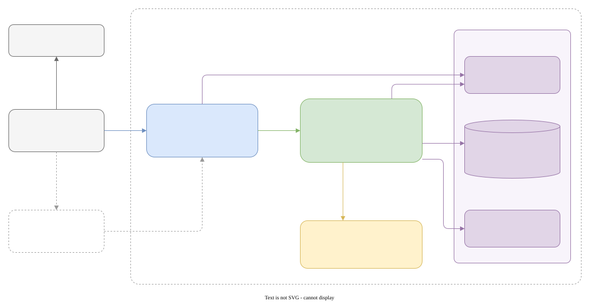

# CampusSwap

A campus exchange for UBC Vancouver. Post items to give away or sell, let AI draft the listing from photos, and find items with AI search on a map.

Everything runs locally and free: the database (Supabase in Docker), the AI model (Ollama), and the map (OpenStreetMap).

## Project structure

```
BCSHacks2026/
├── frontend/                  Next.js app (UI only; talks to Supabase just for sign-in)
│   ├── app/
│   │   ├── page.tsx           Browse: AI search, filters, map + list
│   │   ├── sell/page.tsx      Post an item (photos → AI draft → form)
│   │   ├── item/[id]/page.tsx Item detail + contact seller (opens the buyer's email app)
│   │   └── login/page.tsx     Email + password sign-in / sign-up
│   ├── components/            Header, MapView/LeafletMap, BuildingPicker, ListingCard, ContactModal, ...
│   ├── lib/                   api.ts (backend calls), supabase.ts (auth), location.ts, types.ts
│   └── public/demo/           Photos for the demo listings
│
├── backend/                   FastAPI server (all data, uploads and AI)
│   ├── main.py                All routes
│   ├── ai.py                  Photo analysis + search answers (Ollama), embeddings (local model)
│   ├── db.py                  Every database query
│   ├── auth.py                Checks the sign-in token and campus email domain
│   ├── storage.py             Resizes and uploads photos
│   ├── ubc_buildings.json     Pickup buildings (from OpenStreetMap)
│   ├── config.py, geo.py, models.py
│   └── prompts/               The AI prompts
│
├── supabase/
│   ├── migrations/            Database schema (tables, vector search, photo bucket)
│   ├── seed.sql               Demo listings, loaded automatically
│   └── config.toml            Local Supabase settings
│
├── docs/
│   └── architecture.drawio.svg  Architecture diagram (editable in draw.io)
│
└── seed/
    ├── photos/                Drop photos here to make new demo data
    ├── seed.py                Photos → AI-drafted listings in the database
    └── export_demo.py         Database → supabase/seed.sql + frontend/public/demo/
```

## Architecture



To edit the diagram, open `docs/architecture.drawio.svg` in [draw.io](https://app.diagrams.net) (web, desktop app, or the VS Code extension) and save it back to the same file.

## 1. Prerequisites (one time)

You need **Docker**, **Python 3.10–3.13**, **Node 20+** and **Ollama**.

**macOS** (with [Homebrew](https://brew.sh)): install [Docker Desktop](https://www.docker.com/products/docker-desktop/), then

```bash
brew install python@3.12 node ollama
brew services start ollama
```

**Linux** (Ubuntu/Debian): install [Docker Engine](https://docs.docker.com/engine/install/) and add yourself to the `docker` group ([steps](https://docs.docker.com/engine/install/linux-postinstall/)), install Node 20+ (e.g. via [nvm](https://github.com/nvm-sh/nvm)), then

```bash
sudo apt install python3 python3-venv python3-pip
curl -fsSL https://ollama.com/install.sh | sh     # also starts Ollama as a service
```

**Windows** (PowerShell):

```powershell
winget install Docker.DockerDesktop Python.Python.3.12 OpenJS.NodeJS.LTS Ollama.Ollama
```

Then open Docker Desktop once (it sets up WSL 2) and restart the terminal. Ollama runs from the system tray.

## 2. Install (all platforms, from the repo root)

Make sure Docker is running first.

```bash
# AI model (~3.4 GB, one time)
ollama pull gemma3:4b

# database + auth; the first start creates the tables and loads the demo listings
npx supabase start -x imgproxy,realtime,edge-runtime,logflare,vector,supavisor

# frontend packages
cd frontend
npm install
cd ..
```

Backend packages, **macOS / Linux**:

```bash
cd backend
python3 -m venv .venv                # macOS with Homebrew: python3.12 -m venv .venv
source .venv/bin/activate
pip install torch --index-url https://download.pytorch.org/whl/cpu
pip install -r requirements.txt
cd ..
```

Backend packages, **Windows**:

```powershell
cd backend
py -3.12 -m venv .venv
.venv\Scripts\activate               # if blocked: Set-ExecutionPolicy -Scope CurrentUser RemoteSigned
pip install torch --index-url https://download.pytorch.org/whl/cpu
pip install -r requirements.txt
cd ..
```

Env files (the defaults already point at the local services):

```bash
cp backend/.env.example backend/.env
cp frontend/.env.local.example frontend/.env.local
```

## 3. Run

Two terminals, from the repo root:

```bash
# terminal 1: backend (Windows: .venv\Scripts\activate instead of source)
cd backend
source .venv/bin/activate
uvicorn main:app --reload --port 8000

# terminal 2: frontend
cd frontend
npm run dev                          # open http://localhost:3000
```

- Create an account on the Sign in page with a UBC email and a password (no email verification locally).
- Database UI: http://127.0.0.1:54323

### Open it on your phone (with location)

Phones only share their location with HTTPS sites, so give the app a temporary HTTPS address with a free Cloudflare tunnel (no account needed). Install `cloudflared` once:

- macOS: `brew install cloudflared`
- Windows: `winget install Cloudflare.cloudflared`
- Linux: see [the downloads page](https://developers.cloudflare.com/cloudflare-one/connections/connect-networks/downloads/)

Then, with the app running, in a third terminal:

```bash
cloudflared tunnel --url http://localhost:3000
```

Open the `https://….trycloudflare.com` address it prints on any phone, on any network. It changes every time you run the command, and anyone with the link can open the app while it's running, so stop it (`Ctrl+C`) when you're done.

Without a tunnel you can also use the `Network:` address `npm run dev` prints (e.g. `http://192.168.1.5:3000`) on the same Wi-Fi, but phones won't share location over plain `http`, and some campus networks block it entirely.

**After pulling changes:** run `npx supabase migration up` to apply any new database changes (keeps your data), If new colours or styles don't show up, stop the frontend, delete `frontend/.next` and run `npm run dev` again.

## Demo data

Demo listings live in `supabase/seed.sql`, with photos in `frontend/public/demo/`. To wipe the database back to just the demo data:

```bash
npx supabase db reset
```

To make new demo data, put item photos in `seed/photos/` (one image per item, or one subfolder per item). Then, with the backend venv activated, from the repo root:

```bash
python seed/seed.py --email seed@student.ubc.ca          # AI-drafts and inserts each item
python seed/export_demo.py --email seed@student.ubc.ca   # saves them as the committed demo data
```

## Stop

```bash
npx supabase stop                    # data is kept for next time
```

Ollama keeps running in the background: `brew services stop ollama` (macOS), `sudo systemctl stop ollama` (Linux), or quit it from the tray (Windows).
